# qinqin

qinqin (勤勤, pronounced qínqín) is a self-hosted platform for studying Chinese and Japanese. It brings
dictionary lookup, character readings and stroke order, FSRS flashcards, a reader for books, a journal with
optional AI review and your study statistics together in one small Docker stack: a Go server with a SQLite
database and the SvelteKit web app embedded in the binary.

## Features

- **Dictionaries with their sources**: CC-CEDICT, JMdict, KANJIDIC2 and Unihan bundled; every meaning keeps
  its dictionary's name and licence. Search by written form, reading or meaning, plus radical and part
  lookup, lookup history, personal notes and your own corrections.
- **Flashcards with FSRS**: decks, starter decks from a frequency list, HSK and JLPT level decks, vocab,
  Word Salad, writing, tone, reverse and cloze cards, daily limits, vacation mode and an optimizer.
- **Reader**: import epubs or public-domain works from Aozora Bunko and Project Gutenberg, a Yomitan-style
  lookup popup, pinyin or furigana over words, coverage of what you know, bookmarks, highlights and notes.
- **Grammar lessons** and a **Journal** with an optional AI review, using your own key for the provider you
  choose (Anthropic, OpenAI, Gemini, DeepSeek, Mistral, xAI, Groq, OpenRouter or a custom endpoint), and
  photo import read offline (Tesseract) or by AI.
- **Statistics**: an activity heatmap, daily goals, a weekly summary, milestones and a character mastery map.
- **Workspaces**: keep Chinese and Japanese apart, or split one language into several named workspaces.
- **Themes**: a light and a dark colour theme of your choice, accent, corners, spacing and the hanzi font.
- **Interface language**: every interface text comes from one catalogue (English today); the language is a
  per-user setting.
- **Accounts**: registration modes and invites, two-step sign-in, password reset by mail, personal backup
  and restore, and a server backup for administrators.
- **Installable app**: the web app installs as a PWA and keeps studying offline; reviews sync when you are
  back online.

## Screenshots

Demo data only (a made-up account).

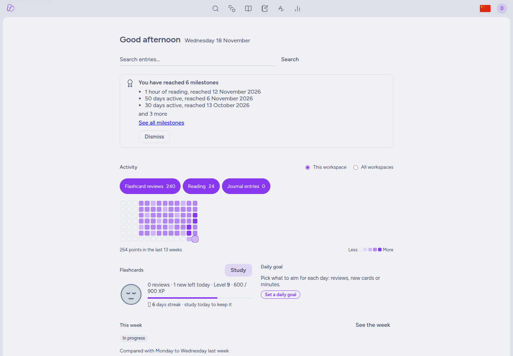

*Home: the garden heatmap, activity by type, the daily goal and the week's numbers.*

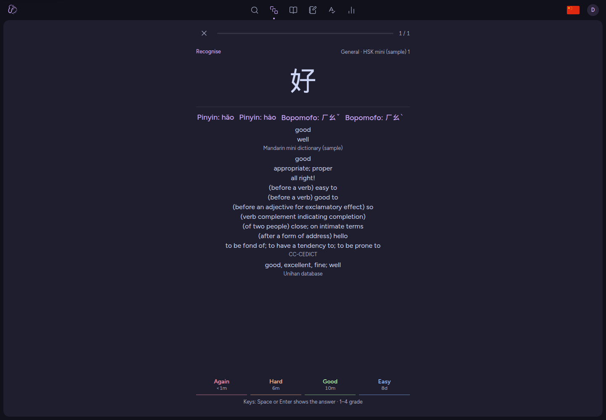

*A flashcard after the answer: readings and meanings, then Again / Hard / Good / Easy with their intervals.*

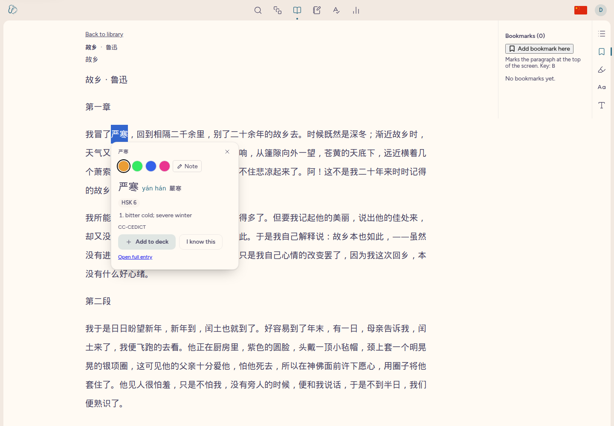

*The reader with a word's lookup popup: readings, level, meanings and Add to deck.*

<details>
<summary>More screenshots</summary>

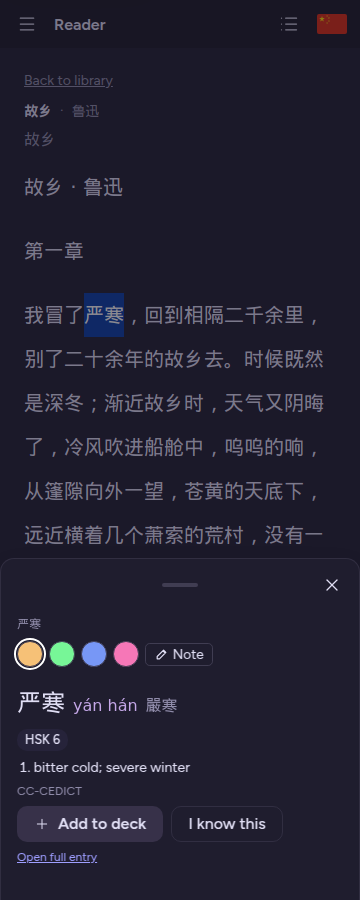

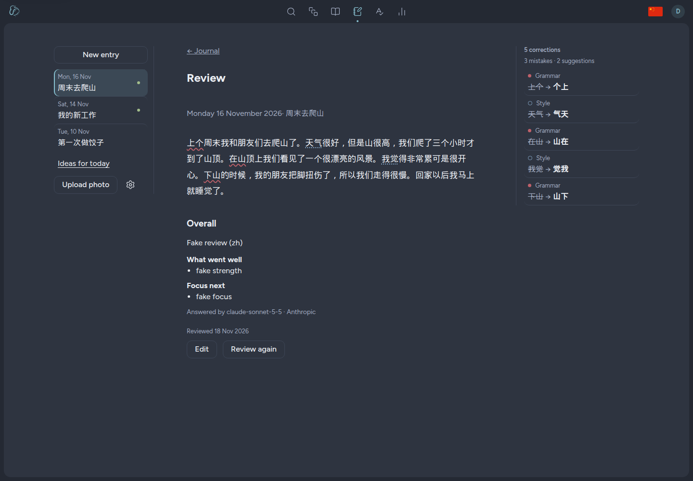

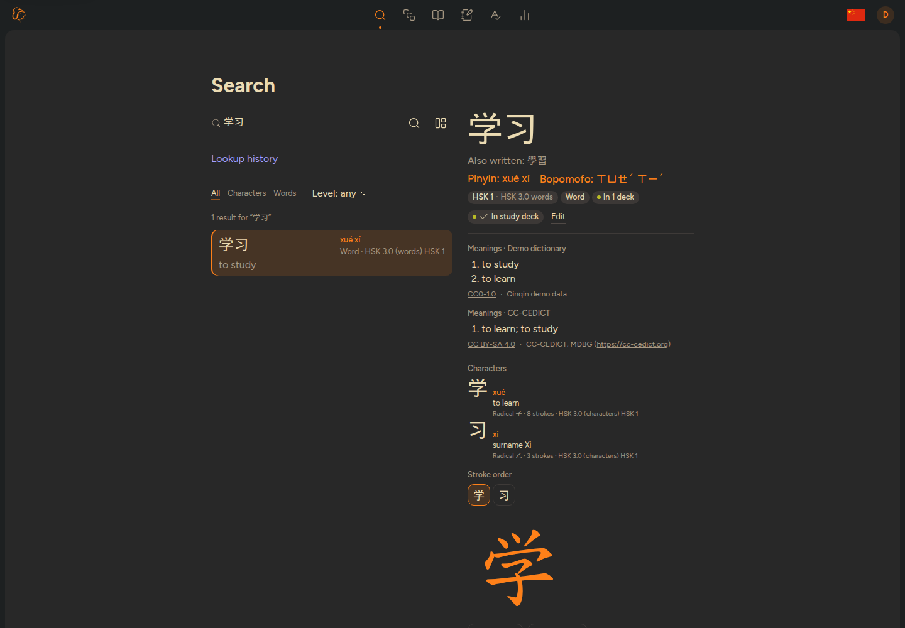

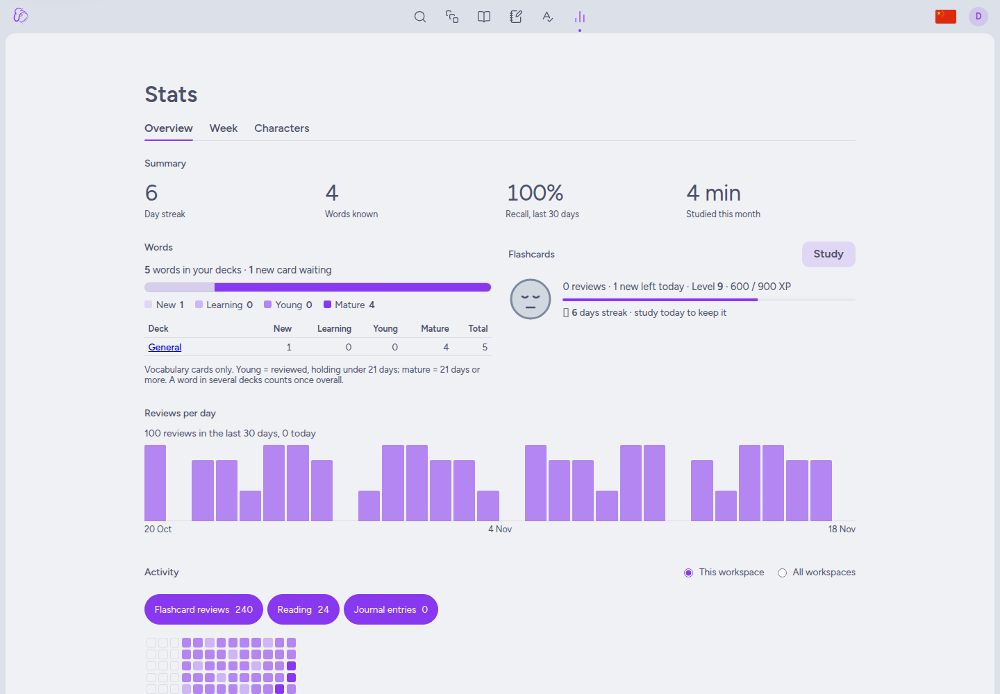

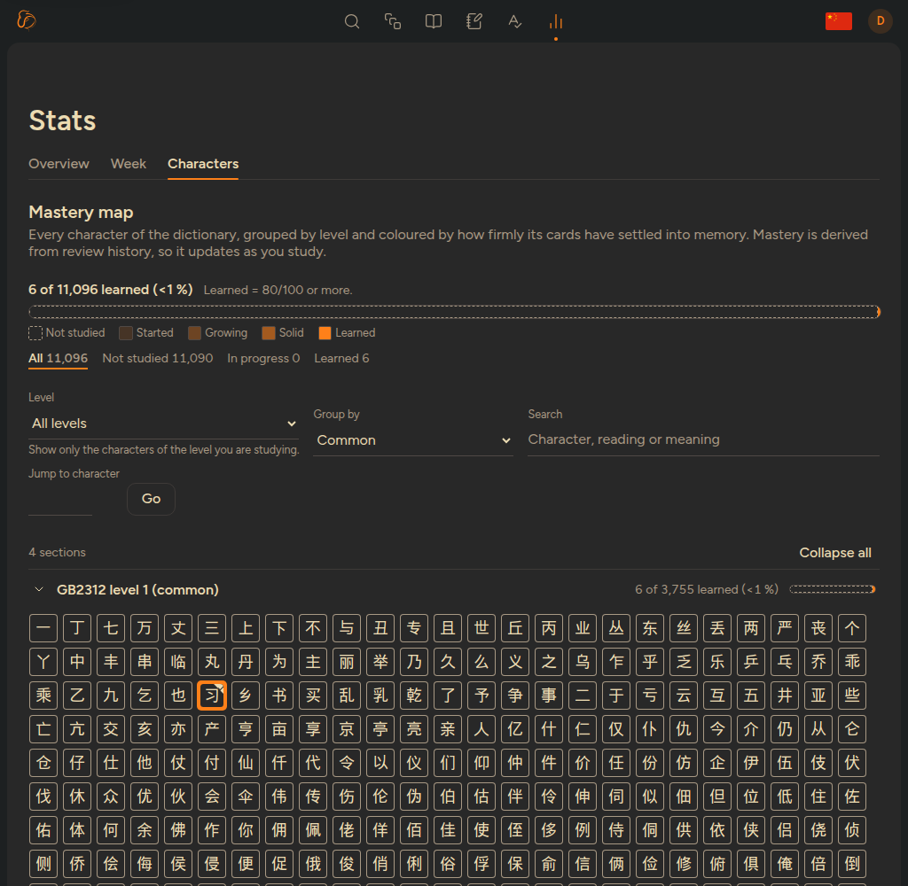

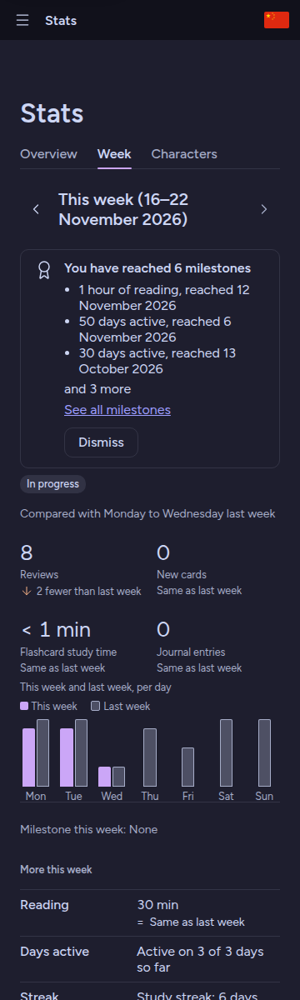

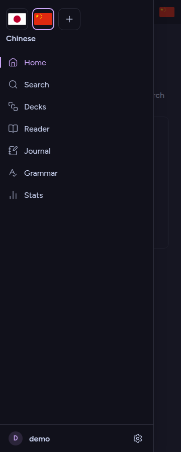

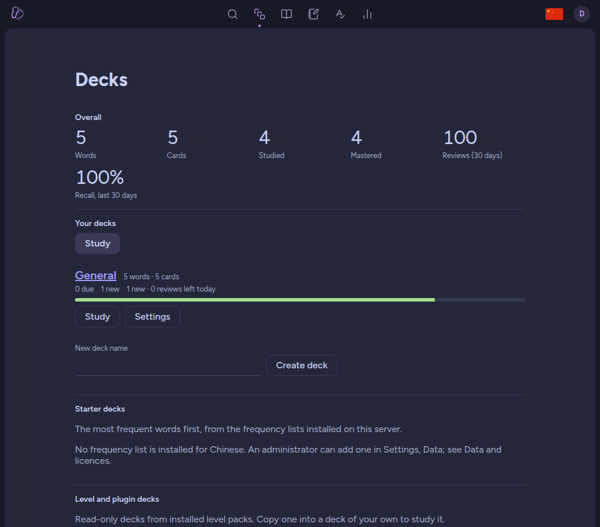

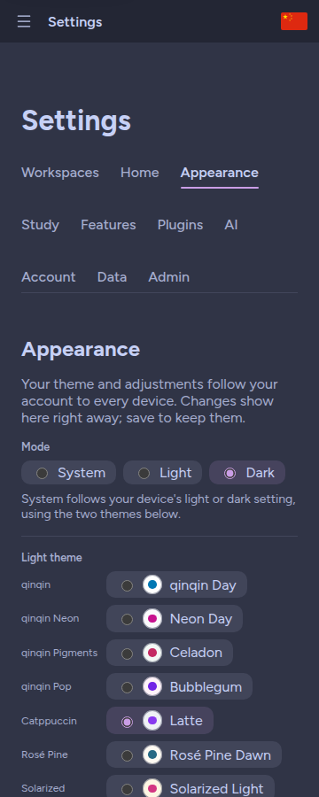

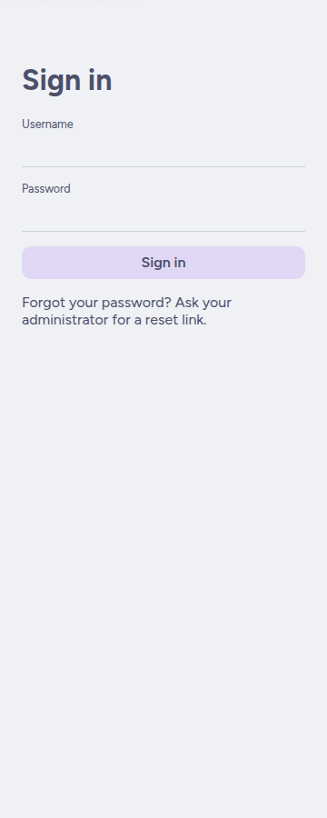

</details>

Dictionary data in the screenshots: CC-CEDICT, CC BY-SA 4.0; text: Lu Xun, public domain; theme credits:
[`docs/sources.md`](docs/sources.md).

## Quick start

You need Docker with the Compose plugin. The repository has one compose file,
[`docker-compose.yml`](docker-compose.yml), for plain Docker Compose and for Portainer (web editor, or
Repository with compose path `docker-compose.yml`). In a folder holding that file:

```sh
docker compose up -d
docker compose exec qinqin qinqin adduser --admin --username you
```

The first start installs the bundled dictionaries, frequency and level lists, stroke data and audio by itself
before it listens (about 2 minutes, once; `QINQIN_AUTO_SEED=0` turns that off). `adduser` asks for a password (10 to 256 characters, not the username). Then open
<http://localhost:8080>.

- **Create the admin before the port is reachable beyond your LAN.** While no user exists, the first
  registration becomes the administrator, whoever makes it. Or set `QINQIN_BOOTSTRAP_ADMIN` to a username:
  on the first start the server creates that admin before it opens the port and prints a one-time password in
  the container log (or uses `QINQIN_BOOTSTRAP_PASSWORD`); it must be changed at the first sign-in.
- **`QINQIN_SECRET` is optional.** Without it the AI features, authenticator apps and a
  stored mail password are unavailable; everything else works. With it
  (`head -c 32 /dev/urandom | base64`) users' AI keys, the mail password and authenticator secrets are stored
  encrypted. Back it up separately from the data volume; it is never written there.
- **No reverse proxy in front?** Set `QINQIN_TRUSTED_PROXIES=none`. For HTTPS (needed to install the app
  and study offline) put a proxy in front: Caddy, Traefik and nginx examples are in the wiki.
- Data lives in the named volume `qinqin-data` (`QINQIN_DATA_VOLUME=./data` bind-mounts a folder instead);
  `QINQIN_PORT` changes the port, `QINQIN_IMAGE` pins the image. Set variables in a `.env` file next to
  `docker-compose.yml` or in the Portainer stack.

Portainer step by step, the data directory and the checklist after deploying:
[Deploying](https://github.com/Elaktrato/qinqin/wiki/Admin-deploying). Every variable:
[Environment variables](https://github.com/Elaktrato/qinqin/wiki/Admin-environment-variables).

## Release images and versions

CI publishes `ghcr.io/elaktrato/qinqin` on pushes to `main` and on `v*` tags (pushes to `develop` only run
the tests). Tags: `latest` (the newest `main` build), `v<version>` for a release (for example `v0.5.0`) and
`sha-<commit>`. For production pin a `v*` tag in `QINQIN_IMAGE`, so a redeploy never changes the version by
surprise. The package is public; an image your own fork publishes starts as a private package (see
[Deploying](https://github.com/Elaktrato/qinqin/wiki/Admin-deploying#release-images-and-versions)).

Every `v*` tag also gets a GitHub Release, created automatically after the image is pushed, with the notes of
`docs/releases/<tag>.md` or GitHub's generated notes. Back up before you upgrade: migrations run at start and
there is no downgrade ([Upgrading](https://github.com/Elaktrato/qinqin/wiki/Admin-upgrading)).

## Documentation

The full documentation is the [qinqin wiki](https://github.com/Elaktrato/qinqin/wiki), generated from
[`docs/wiki/`](docs/wiki/) in this repository.

- **Using qinqin**: [Getting started](https://github.com/Elaktrato/qinqin/wiki/Getting-started),
  [Finding your way](https://github.com/Elaktrato/qinqin/wiki/Finding-your-way),
  [Flashcards](https://github.com/Elaktrato/qinqin/wiki/Flashcards-study-sessions),
  [Reader](https://github.com/Elaktrato/qinqin/wiki/Reader),
  [Journal and AI](https://github.com/Elaktrato/qinqin/wiki/Journal-and-AI),
  [Settings tour](https://github.com/Elaktrato/qinqin/wiki/Settings-tour),
  [Your data](https://github.com/Elaktrato/qinqin/wiki/Your-data),
  [Install and offline](https://github.com/Elaktrato/qinqin/wiki/Install-and-offline).
- **Running a server**: [Deploying](https://github.com/Elaktrato/qinqin/wiki/Admin-deploying),
  [Upgrading](https://github.com/Elaktrato/qinqin/wiki/Admin-upgrading),
  [Users and registration](https://github.com/Elaktrato/qinqin/wiki/Admin-users-and-registration),
  [Email and security](https://github.com/Elaktrato/qinqin/wiki/Admin-email-and-security),
  [Proxy and rate limiting](https://github.com/Elaktrato/qinqin/wiki/Admin-proxy-and-rate-limiting),
  [Backup and recovery](https://github.com/Elaktrato/qinqin/wiki/Admin-backup-and-recovery),
  [Data packs](https://github.com/Elaktrato/qinqin/wiki/Admin-data-packs),
  [AI and OCR](https://github.com/Elaktrato/qinqin/wiki/Admin-AI-and-OCR),
  [Troubleshooting](https://github.com/Elaktrato/qinqin/wiki/Troubleshooting).
- **Building a client**: [API overview](https://github.com/Elaktrato/qinqin/wiki/API-Overview),
  [API reference](https://github.com/Elaktrato/qinqin/wiki/API-Reference),
  [API access tokens](https://github.com/Elaktrato/qinqin/wiki/API-Access-tokens),
  [Plugin format](https://github.com/Elaktrato/qinqin/wiki/Plugin-format),
  [Data pack format](https://github.com/Elaktrato/qinqin/wiki/Data-pack-format), and the shared rules with
  JSON fixtures in [`docs/contracts/`](docs/contracts/overview.md).
- **Reference**: [Data and licences](https://github.com/Elaktrato/qinqin/wiki/Data-and-licences),
  [Dictionary data model](https://github.com/Elaktrato/qinqin/wiki/Dictionary-data-model),
  [FAQ](https://github.com/Elaktrato/qinqin/wiki/FAQ).

## Development

Go 1.26+ and Node.js 24+. Run the server from `server/` with `go run ./cmd/qinqin` (seed it with
`go run ./cmd/qinqin seed --packs ../plugins/data`), and the web app's dev server with
`npm --prefix apps/web install && npm --prefix apps/web run dev` (it proxies `/api` to `127.0.0.1:8080`).

```sh
npm --prefix apps/web run check
npm --prefix apps/web test
npm --prefix apps/web run build
cd server && go vet ./... && go test ./...
```

Branches follow git-flow ([`docs/git-flow.md`](docs/git-flow.md)). The code-structure rules (layers, folders,
errors, tests) are the architecture records in [`docs/architecture/`](docs/architecture/README.md). More,
including the doc checks and the repository layout: [Development](https://github.com/Elaktrato/qinqin/wiki/Development),
[Project layout](https://github.com/Elaktrato/qinqin/wiki/Project-layout),
[Translating qinqin](https://github.com/Elaktrato/qinqin/wiki/Translating-qinqin).

## Licence and credits

The bundled data keeps its own licences: CC-CEDICT, JMdict and KANJIDIC2 (CC BY-SA 4.0), Unihan (Unicode
License v3), the Jiten frequency list (CC BY-SA 4.0), KanjiVG components (CC BY-SA 3.0), the stroke-order
data (Arphic Public License), the HSK 3.0 lists (no reuse licence granted; included with attribution) and
more. [`docs/sources.md`](docs/sources.md) is the licence and attribution reference for every pack, theme,
font and library, and the app's public **Sources** page (`/sources`) shows the credits of what is installed.

The repository contains no licence file for qinqin's own code yet.
